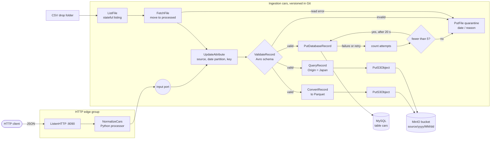
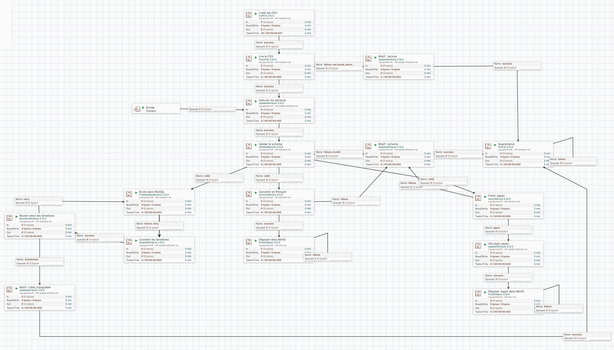
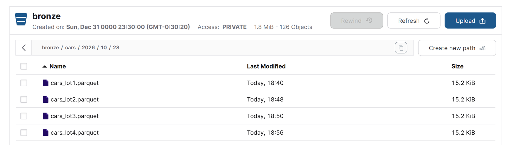

# NiFi ingestion pipeline

[](https://github.com/hamzaziouine/nifi-ingestion-pipeline/actions/workflows/ci.yml)
[](LICENSE)

An Apache NiFi 2 flow that ingests CSV files and HTTP payloads into MySQL and into
date-partitioned Parquet files on S3-compatible storage (MinIO), without losing a row
when something goes wrong. The flow is versioned in this repository by NiFi itself,
through the GitHub Flow Registry Client.

What it does:

- **List, then fetch.** ListFile keeps the newest timestamp it has seen in its state and
  emits attribute-only FlowFiles; FetchFile reads each file once and moves it to a
  `traite/` (processed) folder. Re-listing the folder never reloads a file.
- **Schema validation per row.** ValidateRecord checks every row against an explicit
  Avro schema with strict types. Good rows move on, bad rows are split off with the
  reason, so one broken line does not block a file.
- **Quarantine with reasons.** Nothing is auto-terminated on failure. Read errors, schema
  errors and an unreachable database all end up in `<date>/<reason>/` with the original
  name, and can be replayed from provenance once fixed.
- **Bounded retries and back-pressure.** Failed database writes loop through an attempt
  counter (five attempts, 20 s apart) before going to quarantine. Queue thresholds stop
  upstream work instead of piling data up.
- **Two sinks from one read.** Valid rows go to a MySQL table and, as Parquet, to
  `<bucket>/<source>/yyyy/MM/dd/<file>.parquet`. A third branch uses QueryRecord (SQL on
  the FlowFile) to write a Japan-only subset.
- **HTTP entry point.** ListenHTTP plus a Python processor (NiFi 2 Python API) that turns
  raw JSON into the same CSV layout, so web data follows the exact same path.
- **Configuration out of the flow.** Paths, URLs and credentials live in a parameter
  context; secrets are sensitive parameters and never leave the NiFi instance.

## Architecture



The versioned group as it runs (component names are in French, the
[flow reference](docs/flow.md) translates each one):



## Flow walkthrough

1. **ListFile** lists `#{chemin_in}` every 10 s for `*.csv` files at least 10 s old.
2. **FetchFile** reads the file and moves it to `#{chemin_in}/traite`. If it cannot,
   the FlowFile is tagged `motif=lecture` and quarantined.
3. **UpdateAttribute** derives `source` from the file name (`cars_full.csv` gives
   `cars`), the date partition `yyyy/MM/dd`, and the S3 key. Files coming from the HTTP
   group join here through the input port.
4. **ValidateRecord** splits valid and invalid rows. Invalid rows are quarantined as
   `schema` with `validation.details`; valid rows are cloned to three branches.
5. **MySQL branch.** PutDatabaseRecord inserts in batches of 1000. On failure the
   FlowFile goes through `tentatives = tentatives + 1` and a router that runs every
   20 s: back to the writer while `tentatives < 5`, otherwise quarantine as
   `cible_injoignable` (target unreachable).
6. **Parquet branch.** ConvertRecord writes Parquet, PutS3Object uploads it to
   `#{bucket}` under the computed key and retries in place if the store is down.
7. **Japan branch.** QueryRecord runs `SELECT * FROM FLOWFILE WHERE Origin = 'Japan'`
   and the result is uploaded under `<source>/<date>/japan/`.
8. **Quarantine.** PutFile writes to `<date>/<reason>/<file name>`.

Details, controller services and the reasons behind some settings:
[docs/flow.md](docs/flow.md). Parameters: [docs/parameters.md](docs/parameters.md).
Day-to-day operations (replays, retries, versions, secrets):
[docs/operations.md](docs/operations.md).

## Results from a local run

One session on a single machine (NiFi 2.12.0, MySQL 8.4, MinIO), with the Auto MPG cars
file (398 rows). The table was never truncated, so the count keeps growing:

| Scenario | What happened | `COUNT(*)` after |
|---|---|---|
| 406-row file, 6 rows broken (text in Horsepower, missing Origin), validation only | 400 rows passed, the 6 bad rows (369 bytes) were quarantined under `schema/` | n/a |
| One file | 398 rows inserted, one 15.2 KiB Parquet object under `bronze/cars/2026/10/28/` | 398 |
| MySQL shut down, one file | 3 attempts 20 s apart (version 1 budget), then quarantine under `cible_injoignable/` | 398 |
| 120 files, MySQL writer stopped, `valid` queue threshold lowered to 100 | the queue held at 100, 20 FlowFiles waited upstream, the Parquet branch paused too; after restart every file was loaded, none lost | 48,158 |
| Provenance replay of the quarantined file | validated again and loaded once | 48,556 |
| Flow exported, re-imported, parameters filled in | next file loaded normally | 48,954 |
| HTTP POST of 10 cars | 9 loaded, the car with origin code 4 quarantined under `schema/` | 48,963 |
| Japan branch added, one more file | `japan/` Parquet object with 79 rows, checked with pyarrow | 49,361 |

49,361 = 124 file loads × 398 rows + 9 web rows.



The HTTP test ran with the first version of the Python processor;
`processors/NormalizeCars.py` is a rewrite with the same input and output contract, and
unit tests.

## Run it locally

Requirements: Java 21 or newer, Python 3.12 or newer (for the Python processor), Docker
with Compose.

**1. Backing services**

```bash
cp .env.example .env             # then change every change-me value
docker compose up -d
docker compose logs minio-init   # "bucket bronze ready, user nifi-writer can write to it"
```

This starts MySQL 8.4 (the `cars` table is created from `infra/mysql/01_cars.sql`),
phpMyAdmin on <http://localhost:8081>, and MinIO (API on 9000, console on
<http://localhost:9001>). A one-shot container creates the bucket and a MinIO user that
can only write to it.

**2. NiFi**

```bash
curl -LO https://archive.apache.org/dist/nifi/2.12.0/nifi-2.12.0-bin.zip
unzip nifi-2.12.0-bin.zip && cd nifi-2.12.0

# Parquet support and the MySQL driver are not in the default distribution
curl -L -o lib/nifi-parquet-nar-2.12.0.nar https://repo1.maven.org/maven2/org/apache/nifi/nifi-parquet-nar/2.12.0/nifi-parquet-nar-2.12.0.nar
curl -L -o lib/nifi-hadoop-libraries-nar-2.12.0.nar https://repo1.maven.org/maven2/org/apache/nifi/nifi-hadoop-libraries-nar/2.12.0/nifi-hadoop-libraries-nar-2.12.0.nar
curl -L -o lib/mysql-connector-j-8.4.0.jar https://repo1.maven.org/maven2/com/mysql/mysql-connector-j/8.4.0/mysql-connector-j-8.4.0.jar

# Python processor
cp /path/to/nifi-ingestion-pipeline/processors/NormalizeCars.py python/extensions/
# in conf/nifi.properties: nifi.python.command=python3   (python on Windows)

./bin/nifi.sh set-single-user-credentials <user> <password, 12+ characters>
./bin/nifi.sh start              # bin\nifi.cmd start on Windows
```

Open <https://localhost:8443/nifi> once the log says the UI is available.

**3. Import the flow**

Either from the registry: Controller Settings > Registry Clients > add a
`GitHubFlowRegistryClient` (owner `hamzaziouine`, repository `nifi-ingestion-pipeline`,
branch `main`, a read-only token), then drag a Process Group onto the canvas > Import
from Registry > bucket `flows` > `ingestion-cars` > version 2.

Or from the file: drag a Process Group onto the canvas, click the upload icon and pick
`flows/ingestion-cars.json`.

**4. Parameters and start**

In Parameter Contexts > `Paramètres ingestion cars`, fill in:

| Parameter | Value |
|---|---|
| `chemin_in` | a folder NiFi can read and write, e.g. `/srv/ingestion/in` |
| `mot_de_passe_mysql` | `MYSQL_PASSWORD` from `.env` |
| `cle_acces_minio` / `cle_secrete_minio` | `NIFI_S3_ACCESS_KEY` / `NIFI_S3_SECRET_KEY` from `.env` |

`url_jdbc` and `bucket` already match the compose defaults. Enable the group's controller
services, then start the group.

**5. Feed it**

```bash
cp data/sample/cars_full.csv      /srv/ingestion/in/   # 398 rows to MySQL and MinIO
cp data/sample/cars_malformed.csv /srv/ingestion/in/   # 20 loaded, 5 quarantined
docker compose exec mysql sh -c 'mysql -unifi -p"$MYSQL_PASSWORD" nifi_test -e "SELECT Origin, COUNT(*) FROM cars GROUP BY Origin"'
```

For the HTTP path, build the small edge group described in
[docs/flow.md](docs/flow.md#http-edge-group-not-versioned) (ListenHTTP on 8090,
NormalizeCars, an output port wired to the `Entrée fichiers` input port), then:

```bash
curl -X POST -H "Content-Type: application/json" \
     --data-binary @data/sample/web_cars.json \
     http://localhost:8090/contentListener
```

**Tests** (processor, sample data, and consistency between the flow, the schema and the
DDL; no NiFi needed):

```bash
pip install -r requirements-dev.txt
pytest -q
```

## Version history

The group is under version control in NiFi, with this repository as the registry. NiFi
writes each version as a commit on `flows/ingestion-cars.json`, with the version
comment as the commit message:

| Version | Commit | Change |
|---|---|---|
| registration | [`cb20f40`](https://github.com/hamzaziouine/nifi-ingestion-pipeline/commit/cb20f405672324c64801a8a2b718c9288243ba2a) | flow `ingestion-cars` created in bucket `flows` |
| 1 | [`0b1fbe6`](https://github.com/hamzaziouine/nifi-ingestion-pipeline/commit/0b1fbe6b1848b9d03b747d763ff6b4446c404861) | complete group: list/fetch, validation, quarantine, MySQL with retries, Parquet and Japan branches, parameter context |
| 2 | [`5299118`](https://github.com/hamzaziouine/nifi-ingestion-pipeline/commit/5299118a9d04f3a45fd2054ff61784d7689fc948) | retry budget raised from 3 to 5 attempts |

Version 2 is the kind of change the registry makes reviewable: NiFi lists it as a local
change before the commit, and Git shows it as a one-line diff after:

```diff
-        "retry" : "${tentatives:lt(3)}"
+        "retry" : "${tentatives:lt(5)}"
```

Three attempts 20 s apart give MySQL well under a minute to come back, and a routine
restart can take longer; a valid file then lands in quarantine and needs a manual
replay. Five attempts stretch that window to about a minute and a half. Rolling back is
*Change Version* > 1 in NiFi, and `git diff 0b1fbe6 5299118 -- flows/ingestion-cars.json`
shows the same change from the Git side.

## Things learned building it

- **Avro enums and SQL do not mix.** QueryRecord runs on Calcite, which sees an enum
  field as `JAVA.LANG.OBJECT`: `Origin = 'Japan'` fails, and so does a `CAST`. The query
  branch reads with a copy of the schema where `Origin` is a string. Validation against
  the enum has already happened upstream, so nothing is lost. The first file through
  that branch went to quarantine instead of disappearing, and replaying only the
  QueryRecord event fixed it without inserting into MySQL twice.
- **Enums and JDBC do not mix either.** With the strict reader, PutDatabaseRecord passes
  the enum to the driver as a Java object and MySQL rejects it. The MySQL branch uses an
  inferred reader, which has its own cost: some decimals are typed as 32-bit floats and
  15.6 was stored as 15.600000381469727 in a `DOUBLE` column. The DDL here uses `DECIMAL`.
- **ListFile tracks timestamps, not names.** A file copied with its original
  modification time is older than the last listed file and is silently skipped. Touch it,
  or switch the listing strategy to entity tracking (which costs a state cache).
- **One UpdateAttribute is evaluated in one pass.** Its properties all see the incoming
  attributes, so a key built from `${source}` in the same processor comes out as
  `//file.parquet`. The flow spells the expressions out, and the Japan key uses a second
  UpdateAttribute.
- **Back-pressure on one branch stalls the others.** ValidateRecord feeds all three
  sinks; when the MySQL queue is full it stops, so the Parquet branch waits too, even
  with MinIO up. Separate buffers per sink (or a broker in between) would decouple them.

## Repository layout

```
flows/ingestion-cars.json    flow snapshot, written by NiFi's GitHub registry client
processors/NormalizeCars.py  NiFi 2 Python processor for the HTTP entry point
schemas/cars.avsc            reference copy of the record schema used in the flow
infra/mysql/01_cars.sql      target table, run by the MySQL container on first start
infra/minio/init.sh          bucket and restricted NiFi user, run once by compose
docker-compose.yml           MySQL, phpMyAdmin, MinIO; credentials from .env
data/sample/                 sample inputs built from the UCI Auto MPG dataset
scripts/make_sample_data.py  rebuilds data/sample from the original dataset
tests/                       pytest suite (processor, sample data, flow contract)
docs/                        flow reference, parameters, operations runbook
```

## Tech stack

| Area | Tools |
|---|---|
| Orchestration | Apache NiFi 2.12.0 (Java 21+): record processors, Python processor API |
| Formats | CSV, JSON, Avro schema, Parquet |
| Sinks | MySQL 8.4, MinIO (S3 API) |
| Versioning | NiFi GitHub Flow Registry Client |
| Tooling | Docker Compose, Python 3.12+, pytest, GitHub Actions |

## Limitations and next steps

- **Not idempotent.** The table has no business key, so dropping the same file twice
  inserts it twice (the run above loaded the same 398 rows 124 times on purpose). Next:
  a unique key with an upsert, or DetectDuplicate on a content hash.
- **Some settings are still hard-coded**: S3 endpoint, database user, quarantine base
  directory, retry budget. They should move to the parameter context
  ([list](docs/parameters.md#settings-that-are-not-parameters-yet)).
- **The HTTP edge group is not versioned** and has no TLS or authentication. It should
  become its own versioned group with HandleHttpRequest/HandleHttpResponse, so clients
  get a proper status code.
- **Single node.** In a cluster, ListFile has to run on the primary node only, with load
  balancing on the next connection.
- **Fixed retry spacing.** Attempts are paced by the router's 20 s schedule, not by an
  exponential backoff.
- Parquet files are written uncompressed; Snappy or ZSTD would cut their size.
- Component and parameter names are in French, as the flow was built in a French UI.
  Renaming them is a flow change and would go through a new version.

## License

Code and flow: [MIT](LICENSE), Hamza Ziouine.

Sample data: derived from Quinlan, R. (1993). *Auto MPG*. UCI Machine Learning
Repository, https://doi.org/10.24432/C5859H, licensed CC BY 4.0
(see [data/README.md](data/README.md)).
