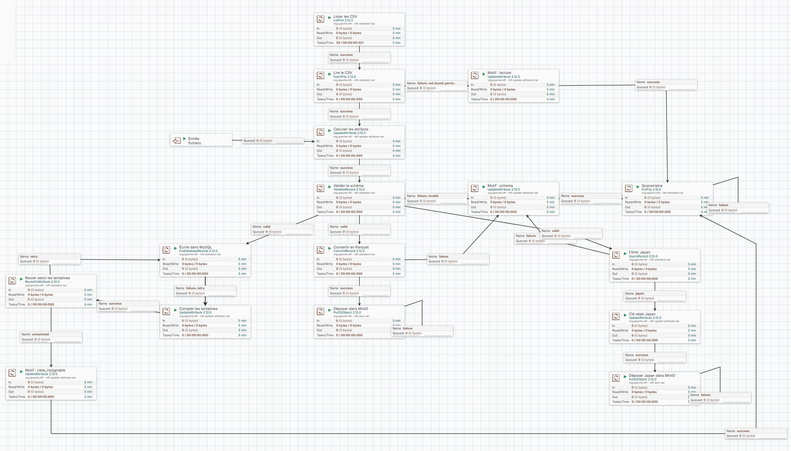
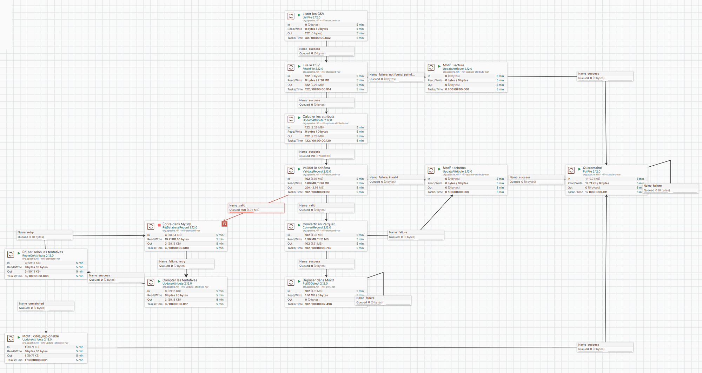
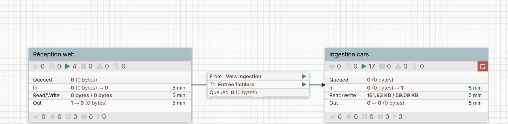

# Flow reference

The versioned process group is `Ingestion cars` (`flows/ingestion-cars.json`). Component
names are in French because the flow was built in a French NiFi UI; the English meaning is
given next to each one. Property values below are copied from the committed snapshot.

## Attributes the flow relies on

| Attribute | Set by | Value |
|---|---|---|
| `source` | Calculer les attributs | `${filename:substringBefore('_')}`, so `cars_full.csv` gives `cars` and `web_20261028_175415_123.csv` gives `web` |
| `partition` | Calculer les attributs, Motif : lecture | `${now():format('yyyy/MM/dd')}` |
| `cible` (target key) | Calculer les attributs, Clé objet Japan | `<source>/<yyyy/MM/dd>/<basename>.parquet` and `<source>/<yyyy/MM/dd>/japan/<basename>.parquet` |
| `motif` (reason) | the three `Motif : ...` processors | `lecture`, `schema` or `cible_injoignable` |
| `tentatives` (attempts) | Compter les tentatives | `${tentatives:replaceNull(0):plus(1)}` |
| `validation.details` | Valider le schéma | why records were rejected, truncated to 1024 characters |

File names therefore follow `<source>_<anything>.csv`. A file without an underscore still
works, but its whole name becomes the source prefix.

## Components, in the order a file meets them

### Discovery and read

| Component | Type | Role |
|---|---|---|
| Lister les CSV (list CSV files) | ListFile | Lists `#{chemin_in}` every 10 s, filter `.*\.csv`, minimum age 10 s, no recursion. Listing strategy *tracking timestamps*: the processor keeps the newest modification time it has seen in its state and skips anything older. Emits attribute-only FlowFiles. |
| Lire le CSV (fetch CSV) | FetchFile | Reads `${absolute.path}/${filename}`, then moves the source file to `#{chemin_in}/traite` (processed). `failure`, `not.found` and `permission.denied` all go to quarantine, nothing is auto-terminated. |
| Entrée fichiers (files in) | Input port | Entry for other groups, for example the HTTP edge group. Joins the file path right after FetchFile. |
| Calculer les attributs (compute attributes) | UpdateAttribute | Sets `source`, `partition` and `cible`. `cible` spells out both expressions instead of reusing `${source}`: all properties of one UpdateAttribute are evaluated against the incoming attributes, so `source` does not exist yet at that point. |

### Validation

| Component | Type | Role |
|---|---|---|
| Valider le schéma (validate schema) | ValidateRecord | Reader `CSVReader cars` with the explicit Avro schema (`schemas/cars.avsc`), strict type checking, extra fields allowed. Valid rows leave as one FlowFile cloned to three branches; invalid rows leave as a separate FlowFile to quarantine with `validation.details`. A file with a few bad rows is not blocked. |

### Branch 1: MySQL with bounded retries

| Component | Type | Role |
|---|---|---|
| Écrire dans MySQL (write to MySQL) | PutDatabaseRecord | `INSERT` into `cars`, batch size 1000, reader `CSVReader MySQL` (inferred schema, see below), pool `MySQL nifi_test`. `success` is terminated; `failure` and `retry` go to the counter. |
| Compter les tentatives (count attempts) | UpdateAttribute | Increments `tentatives`. |
| Router selon les tentatives (route on attempts) | RouteOnAttribute | Runs every 20 s, which spaces the attempts. `retry` = `${tentatives:lt(5)}` goes back to the writer; `unmatched` goes to quarantine. Five attempts in total (three in version 1). |
| Motif : cible_injoignable (reason: target unreachable) | UpdateAttribute | `motif = cible_injoignable`. |

### Branch 2: Parquet on S3-compatible storage

| Component | Type | Role |
|---|---|---|
| Convertir en Parquet (convert to Parquet) | ConvertRecord | `CSVReader cars` to `ParquetRecordSetWriter`, uncompressed. Failure goes to quarantine as `schema`. |
| Déposer dans MinIO (put to MinIO) | PutS3Object | Bucket `#{bucket}`, key `${cible}`, endpoint `http://localhost:9000`, path-style access, region `us-east-1`, credentials from `Identifiants MinIO`. `failure` loops back on itself, so the object is retried until the store answers. |

### Branch 3: Japan subset

| Component | Type | Role |
|---|---|---|
| Filtrer Japan (filter Japan) | QueryRecord | `SELECT * FROM FLOWFILE WHERE Origin = 'Japan'`, reader `CSVReader requêtes`, Parquet writer. `original` is terminated, `failure` goes to quarantine. |
| Clé objet Japan (Japan object key) | UpdateAttribute | `cible = ${source}/${partition}/japan/<basename>.parquet`. |
| Déposer Japan dans MinIO | PutS3Object | Same settings as the main Parquet put. |

### Quarantine

| Component | Type | Role |
|---|---|---|
| Motif : lecture / Motif : schema | UpdateAttribute | Tag the reason (and the partition for read errors, which happen before it is computed). |
| Quarantaine (quarantine) | PutFile | Writes to `<base dir>/${partition}/${motif}/<filename>`, creates missing directories, replaces on name conflict. The base directory is a relative path, resolved against the NiFi working directory. `failure` loops back on itself. |

Nothing in the group is auto-terminated except successful writes and QueryRecord's `original`.

## Controller services

| Service | Type | Notes |
|---|---|---|
| CSVReader cars | CSVReader | Schema text property, header line, `Origin` as an Avro enum `US / Europe / Japan`, `Horsepower` nullable. Used for validation and Parquet conversion. |
| CSVReader requêtes (query reader) | CSVReader | Same schema with `Origin` as a plain string. QueryRecord runs on Calcite, which sees an Avro enum as `JAVA.LANG.OBJECT` and refuses `Origin = 'Japan'` (even a `CAST` fails). Validation against the enum already happened upstream, so relaxing it here is safe. |
| CSVReader MySQL | CSVReader | Inferred schema. With the strict reader, PutDatabaseRecord hands the enum to the JDBC driver as a Java object and MySQL rejects it. Inference reads `Origin` as a string. |
| CSVRecordSetWriter cars | CSVRecordSetWriter | Writer for ValidateRecord outputs, inherits the record schema. |
| ParquetRecordSetWriter | ParquetRecordSetWriter | Inherits the record schema, no compression. |
| MySQL nifi_test | DBCPConnectionPool | URL `#{url_jdbc}`, driver `com.mysql.cj.jdbc.Driver` (jar in NiFi's `lib/`), user `nifi`, password `#{mot_de_passe_mysql}`, 8 connections max. |
| Identifiants MinIO (MinIO credentials) | AWSCredentialsProviderControllerService | Access and secret key from sensitive parameters. |

## Back-pressure

Every connection keeps NiFi's defaults: 10,000 FlowFiles or 1 GB. When a queue reaches
its threshold, NiFi stops scheduling the component that feeds it. Because ValidateRecord
feeds all three branches, a full queue in front of MySQL also pauses the Parquet and
Japan branches. Nothing is lost, the work waits upstream.

The capture above comes from a test with the MySQL writer stopped and the threshold of
the `valid` queue in front of it lowered to 100 (since restored to 10,000): the queue is
red at 100, 20 FlowFiles wait in front of ValidateRecord, and ListFile/FetchFile keep
going until their own queues fill. It was taken before the Japan branch existed.

## HTTP edge group (not versioned)

The root canvas also holds a small group that feeds the input port:

| Component | Settings |
|---|---|
| ListenHTTP | Listening Port `8090`, Base Path `contentListener` |
| NormalizeCars (Python, `processors/NormalizeCars.py`) | defaults: `Origin Mapping = 1=US,2=Europe,3=Japan`, `Source Prefix = web` |
| Output port `Vers ingestion` | connected to the `Entrée fichiers` input port of `Ingestion cars` |
| PutFile (web quarantine) | receives NormalizeCars `failure` (unreadable JSON) |

It is not part of the versioned snapshot, so it has to be recreated by hand (four
components, see the README). Putting it under version control is on the list in the README.
