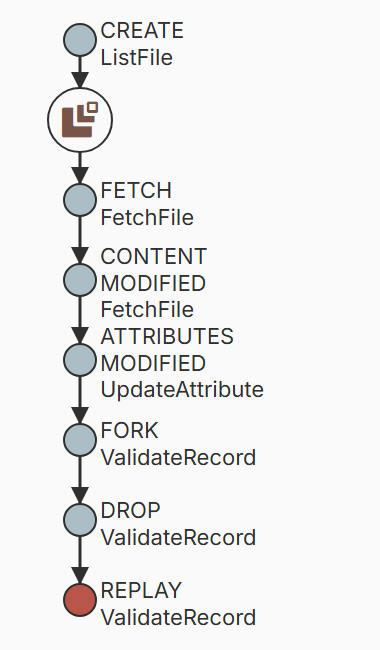

# Operations runbook

## Where a rejected file ends up

Quarantine layout: `<quarantine dir>/<yyyy/MM/dd>/<reason>/<file name>`.

| Reason (`motif`) | Meaning | What is in the file |
|---|---|---|
| `lecture` | FetchFile could not read the file (missing, permission denied, I/O error) | nothing: the listing FlowFile carries no content |
| `schema` | rows that failed validation, or a failure in ConvertRecord / QueryRecord | only the rejected rows, with a header |
| `cible_injoignable` | MySQL still failing after the retry budget | all valid rows of the file |

PutFile writes content only. The reason per row (`validation.details`) and the attempt
count (`tentatives`) are attributes: open Data Provenance, search by file name, and read
them on the Attributes tab of the event.

## Replaying from quarantine

### Rows rejected by the schema

Fix the rows, then drop the file back into `#{chemin_in}`. Two details:

- ListFile tracks timestamps: a file whose modification time is older than the last
  listed file is ignored. Copy tools often preserve the old time, so touch the file
  (`touch f.csv`, or in PowerShell `(Get-Item f.csv).LastWriteTime = Get-Date`).
- Keep the `<source>_` prefix in the name, it decides the S3 prefix.

### Database was down (`cible_injoignable`)

The content was valid, only MySQL was missing. Two options:

1. **Provenance replay** (preferred). In Data Provenance, find the `FORK` event of
   `Valider le schéma` for that file and click Replay. The original FlowFile goes back
   into ValidateRecord with its original attributes, so the Parquet objects are written
   again under the same key (an overwrite, not a duplicate) and MySQL gets the rows once.
   To re-run a single branch, replay the event of that branch instead. Example: after a
   QueryRecord fix, replaying the `Filtrer Japan` event rebuilds the Japan file without
   touching MySQL.

   

   Lineage of a replayed file: listed, fetched, attributes set, forked by ValidateRecord,
   the original dropped, then the `REPLAY` event that sent it through again.
2. **File drop**. Put the quarantined file back into `#{chemin_in}`. It is re-processed
   with today's date, so if the original day has passed, the Parquet copy lands in a new
   date partition next to the old one.

Replay needs the content to still be in the content repository archive
(`nifi.content.repository.archive.*` in `nifi.properties`). Old events can only be
replayed for as long as the archive keeps them.

## Retries and back-pressure

- A failed MySQL write is retried until `tentatives` reaches 5, one attempt per run of
  the router (every 20 s), so a file spends roughly 80 to 100 s retrying before it goes
  to quarantine.
- To change the budget, edit `retry` on `Router selon les tentatives`. The router must be
  stopped to edit it. Commit the change as a new flow version.
- Queues keep NiFi's defaults (10,000 FlowFiles / 1 GB). A full queue pauses the
  component that feeds it; red queues in the UI show where. Stopping the MySQL writer
  for maintenance therefore pauses the two S3 branches too, once the `valid` queue is full.

## Versioning

The group is versioned with NiFi's GitHub registry client. Each NiFi commit is one Git
commit that rewrites `flows/ingestion-cars.json`; the commit message is the version
comment typed in NiFi.

Registry client settings (Controller Settings > Registry Clients > `GitHubFlowRegistryClient`):

| Property | Value |
|---|---|
| Repository Owner | `hamzaziouine` |
| Repository Name | `nifi-ingestion-pipeline` |
| Default Branch | `main` |
| Authentication Type | Personal Access Token |
| Personal Access Token | a fine-grained token limited to this repository, *Contents: read and write* (read-only is enough to import) |

The bucket is the `flows/` folder and the flow id is `ingestion-cars`.

Common actions on the group (right click > Version):

| Action | Use |
|---|---|
| Show local changes | diff between the canvas and the version it came from |
| Commit local changes | creates the next version; write a comment that says why |
| Revert local changes | back to the last committed version |
| Change version | move to any version, older or newer |

Remove the token from the registry client when you are not committing. The client then
shows as invalid and NiFi can no longer check for newer versions, which is harmless;
paste a token again before the next commit.

## Rotating secrets

Update the sensitive parameter in the context. NiFi stops the referencing service and the
processors that use it, applies the value and restarts them. Nothing changes in Git.

## Troubleshooting

| Symptom | Cause and fix |
|---|---|
| `Public Key Retrieval is not allowed` from the pool | MySQL 8 `caching_sha2_password` over a plain connection. Use TLS, or for a local setup only append `?allowPublicKeyRetrieval=true&useSSL=false` to `url_jdbc`. |
| A new CSV is never picked up | its modification time is older than the newest file already listed (see above), or it is younger than the 10 s minimum age, or the name does not end in `.csv`. |
| `Cannot apply '=' to ... JAVA.LANG.OBJECT` in QueryRecord | the query runs on an Avro enum. Use a reader where the field is a string (that is what `CSVReader requêtes` is for). |
| Decimals such as `15.600000381469727` in MySQL | the inferred reader typed the column as a 32-bit float and the table column is `DOUBLE`. The DDL in `infra/mysql` uses `DECIMAL` for that reason. |
| Parquet object with an empty prefix (`//cars_full.parquet`) | the key was built from attributes that did not exist yet. Attributes set in one UpdateAttribute are not visible to the other properties of the same processor. |
| NormalizeCars missing from the processor list | `nifi.python.command` does not point to a Python 3 interpreter, or the file is not in `python/extensions`. The first discovery after a start takes a while; check the NiFi logs. |
